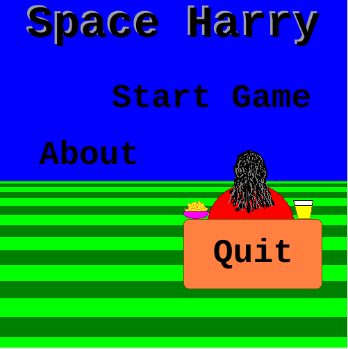
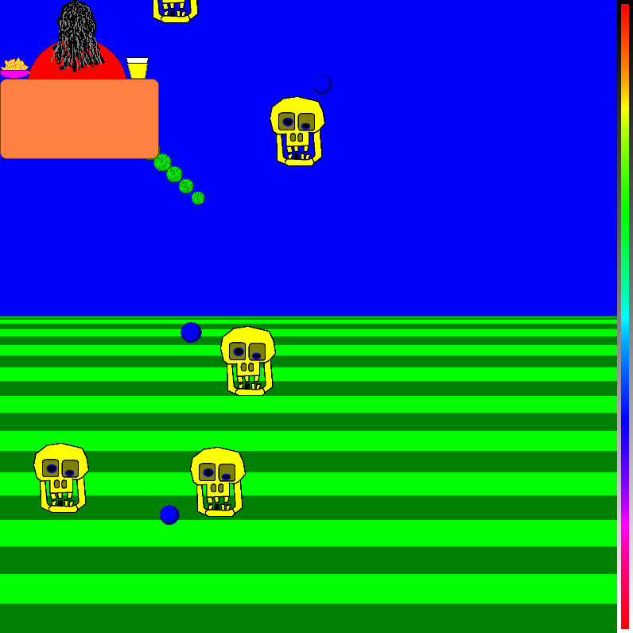
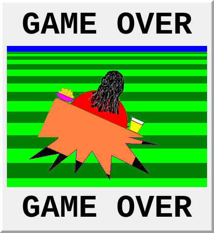
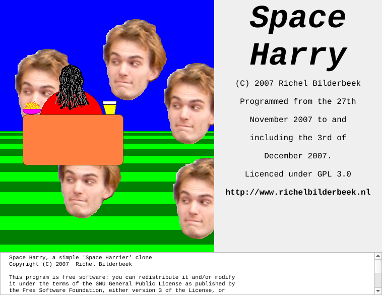

# Space Harry

Space Harry is a simple 'Space Harrier' clone,
written in C++ using the Qt library.

Shoot the skulls before they shoot you!

[Play Space Harry in your browser](play.md).

## Gameplay

Fly around and shoot the skulls flying towards you.
Each skull needs two hits.
The lifebar on the right shows how much life you have left.

When your life runs out, the game is over:

## Controls

Key        | Action
-----------|-------------------------
Arrow keys | Move Harry
Space      | Shoot
F1         | Toggle transparent Harry
Escape     | Quit the game

## About

Space Harry was programmed from the 27th of November 2007
to and including the 3rd of December 2007 by Richel Bilderbeek,
originally using the C++ VCL library.
In 2026 it was converted to use the C++ Qt library.

Space Harry is licensed under the
[GPL 3.0](https://github.com/richelbilderbeek/SpaceHarry/blob/master/LICENSE).
